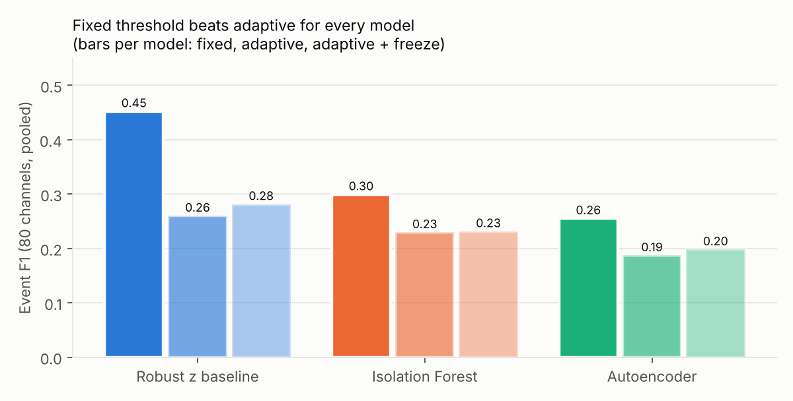
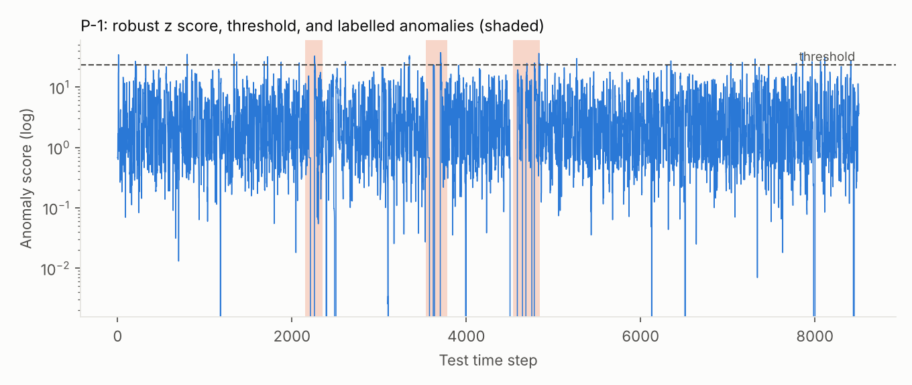
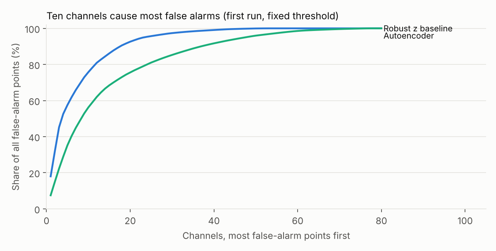
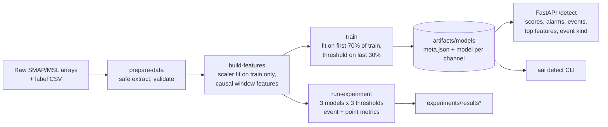

# AAI: Adaptive Anomaly Intelligence

Anomaly detection on multivariate spacecraft telemetry from the public NASA SMAP and MSL
benchmark (Hundman et al., KDD 2018): a leakage-safe data pipeline, three detectors compared on
equal terms, an adaptive-threshold experiment, explanations for alarms, and a FastAPI service
that serves the saved models.

**The honest summary:** a plain robust z-score baseline beat Isolation Forest and a PyTorch
autoencoder on event F1, and my adaptive threshold made every model worse. The autoencoder ranks
anomalies best (highest PR-AUC) but its alarms are too noisy. The failures are written up below,
with the cause I found for the false alarms.

## Results

80 scored channels (53 SMAP, 27 MSL), pooled. Event metrics use the rules in
[`docs/evaluation_protocol.md`](docs/evaluation_protocol.md): a true anomaly counts as detected if
at least one alarm falls inside it, with **no point-adjust**. All numbers are produced by
`aai run-experiment` with [`configs/experiment_v2.yaml`](configs/experiment_v2.yaml) and stored in
[`experiments/results_v2/`](experiments/results_v2). Thresholds are calibrated on train data only.
Nothing was tuned on test labels.

| Model | Threshold | Event precision | Event recall | Event F1 | Normal time flagged | Median delay (steps) | Point-level PR-AUC |
|---|---|---|---|---|---|---|---|
| Robust z baseline | fixed | 0.34 | 0.66 | 0.452 | 3.3% | 31.0 | 0.256 |
| Robust z baseline | adaptive | 0.16 | 0.69 | 0.260 | 9.2% | 16.0 | 0.256 |
| Robust z baseline | adaptive + freeze | 0.18 | 0.70 | 0.281 | 12.8% | 14.0 | 0.256 |
| Isolation Forest | fixed | 0.19 | 0.66 | 0.299 | 12.6% | 23.5 | 0.244 |
| Isolation Forest | adaptive | 0.16 | 0.40 | 0.229 | 4.2% | 27.0 | 0.244 |
| Isolation Forest | adaptive + freeze | 0.16 | 0.42 | 0.231 | 4.9% | 27.0 | 0.244 |
| Autoencoder | fixed | 0.15 | 0.81 | 0.255 | 20.8% | 22.0 | 0.354 |
| Autoencoder | adaptive | 0.11 | 0.60 | 0.187 | 10.2% | 23.5 | 0.354 |
| Autoencoder | adaptive + freeze | 0.12 | 0.61 | 0.198 | 11.6% | 25.0 | 0.354 |
| *Reference* | *Always on* | 1.00 | 1.00 | 1.000 | 100.0% | 0.0 | 0.123 |
| *Reference* | *Never on* | 0.00 | 0.00 | 0.000 | 0.0% | n/a | 0.123 |
| *Reference* | *Random (0.5% of steps)* | 0.11 | 0.58 | 0.191 | 0.5% | 84.5 | 0.123 |

How to read this:

* **Event F1 alone can be gamed.** "Always on" scores 1.0, so always read it next to the share of
  normal time flagged and the delay. Random alarms at the same rate score 0.19.
* **Best event F1: the baseline with a fixed threshold (0.452)**, flagging 3.3% of normal time.
* **Best ranking: the autoencoder** (point-level PR-AUC 0.354 against a 0.123 anomaly rate; the
  other two are about 0.25). But its fixed threshold flags 20.8% of normal time.
* **Adaptive thresholds lost** for all three models. See the failed experiments below.
* Median delay is measured from the start of each true anomaly. Many true anomalies are long (hundreds
  of steps), so a delay of 20 to 30 steps is short relative to their length.
* Cost per 1,000 rows of scoring: baseline 0.003 ms, autoencoder 0.14 ms, Isolation Forest
  5.2 ms; peak traced Python/NumPy memory is at most 1.4 MB (PyTorch's native memory is not
  counted).



Sensitivity to the false-alarm budget (0.99, 0.995, 0.999) and the alarm hold (0, 20, 50 steps) is
in `experiments/results_v2/sensitivity.csv`; it was reported in full and never used to pick a
winner.



*P-1 is an arbitrary example (not picked for looking good): the score crosses the threshold
inside the labelled anomalies, and also outside them.*

## Failed experiments and what I learned

Full diagnosis: [`docs/diagnosis.md`](docs/diagnosis.md).

1. **The first results looked bad because of a few channels.** With a threshold set for 0.5% false
   alarms, the baseline flagged 7.5% of normal time and the autoencoder 26%. Ten channels produced
   71% of the baseline's false-alarm points. Several of them (C-2, D-12, A-1, R-1) never change
   in train, so their calibrated threshold is about zero and any change in test raises an alarm.
   The autoencoder also divided never-varying features by a tiny number.

   

2. **Fixing that cut false alarms but barely raised F1.** Ignoring constant features and a 3.5
   floor on the baseline's score cut the share of normal time flagged (baseline 7.5% to 3.3%,
   autoencoder 26% to 20.8%) while event F1 stayed about the same. Switching alarms off on
   channels with a flat train signal reduced false alarms further but lost recall, because those
   channels contain real anomalies. The fixes also lowered the autoencoder's PR-AUC from 0.436
   to 0.354, so part of its first-run ranking score came from the exploding features. I did not
   tune further, because more rounds on the test set would turn it into a tuning set.

3. **Adaptive thresholds did not help.** Adaptive uses the median plus a multiple of the spread
   of recent scores. It lowered F1 for every model (for example baseline 0.452 to 0.260), even
   with a guard that keeps flagged scores out of the rolling baseline.

4. **A first adaptive rule eroded its own baseline.** The rolling-quantile version with the
   freeze guard keeps anomalies out of the baseline, so the baseline only contains low scores and
   the threshold keeps falling: it flagged 12.7% (baseline), 27.2% (Isolation Forest) and 32.7%
   (autoencoder) of normal time. This is the baseline-corruption safeguard backfiring.

5. **An exploratory result I cannot claim.** The rolling-quantile rule *without* the guard did
   better than the fixed threshold for the autoencoder (event F1 0.300 against 0.255, normal time
   flagged 7.6% against 20.8%) and about the same for Isolation Forest (0.295 against 0.299). I
   found this by looking at test results after the main experiment, so I did not make it the
   headline. Confirming it needs data that was not used to choose it
   ([`experiments/exploratory_quantile_rule.csv`](experiments/exploratory_quantile_rule.csv)).

## Architecture



* **Leakage-safe features:** the scaler is fit on train only, every feature at time `t` uses only
  points up to `t`, and test features use the end of train as history. Tests check this by
  changing future values.
* **Models** (one per channel): robust z-score baseline, Isolation Forest, autoencoder
  (10-16-4-16-10, PyTorch).
* **Explanations:** per-feature contributions (real for the baseline and the autoencoder, a proxy
  for Isolation Forest) and a rule-based event label (spike, variance change, sustained shift,
  no clear change). The label is a heuristic from the telemetry value only.
* The service serves the **fixed** threshold only, since adaptive thresholds did not help.

## Setup

```bash
python -m venv .venv
# Windows: .venv\Scripts\activate    Linux/macOS: source .venv/bin/activate
pip install -e ".[dev,api]"          # add ,deep for the autoencoder (PyTorch)
pytest
```

## Run it

```bash
aai prepare-data --archive path/to/archive.zip   # raw arrays + labels (see Data)
aai inspect-data                                 # docs/data_report.md
aai build-features                               # data/processed/*.npz
aai run-experiment --config configs/experiment_v2.yaml --out-dir experiments/results_v2 \
                   --scores-dir artifacts/scores
aai train                                        # artifacts/models/<model>/<channel>/
aai detect --channel P-1 --model robust_z --input window.npy
aai serve                                        # http://127.0.0.1:8000/docs
```

Send telemetry to the service (column 0 is the value, the other columns are 0/1 command flags;
at least 51 rows are needed so the longest window has history):

```bash
curl -s localhost:8000/detect -H 'content-type: application/json' \
  -d '{"channel": "P-1", "model": "robust_z", "rows": [[0.1, 0, 0, ...], ...]}'
```

Endpoints: `GET /health`, `GET /channels`, `POST /detect`, `GET /metrics` (Prometheus text).
Each request logs one JSON line with the channel, rows, alarm events and latency.

Docker (artifacts are mounted, not baked in; add `--build-arg WITH_TORCH=1` to serve the
autoencoder):

```bash
docker build -t aai .
docker run -p 8000:8000 -v "$PWD/artifacts/models:/models:ro" aai
```

The Dockerfile has not been built in the environment where this was developed; please run the
two commands above once before relying on it.

## Data

Raw data is not committed. The original download link (an S3 bucket) is dead; the same files are
distributed as the Kaggle dataset `patrickfleith/nasa-anomaly-detection-dataset-smap-msl`
(free account needed). Download the zip in your browser, then run `aai prepare-data`.
`prepare-data` extracts only the train and test arrays and downloads the label file from the
original telemanom repository.

Two channels are excluded from scoring because their labels are ambiguous or missing (`P-2` has
two conflicting label rows, `T-10` has none). All dataset statistics are in
[`docs/data_report.md`](docs/data_report.md), generated from the raw files.

## Limitations

* One split of one benchmark: no confidence intervals, one random seed, no repeated runs.
* Event F1 depends on the matching rules (documented, no point-adjust) and cannot be compared
  with papers that use point-adjust.
* Thresholds assume the train data shows normal behaviour. On channels where train is flat, they
  are unreliable, and the API warns about it.
* The alarm hold in `/detect` only sees the submitted window, not earlier history.
* Isolation Forest artifacts are loaded with `joblib`. Only load artifacts you trained yourself.
